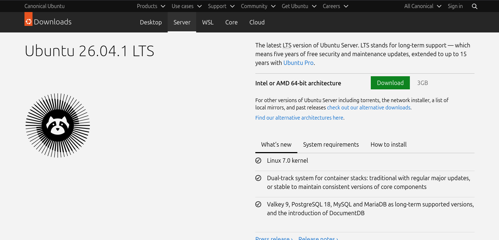
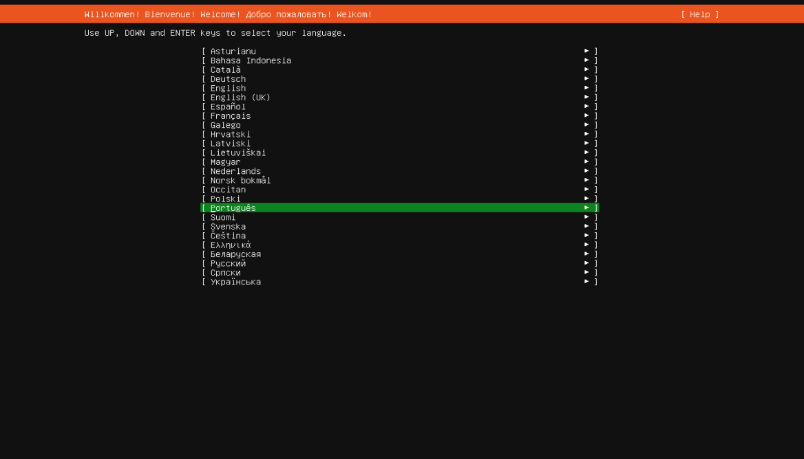
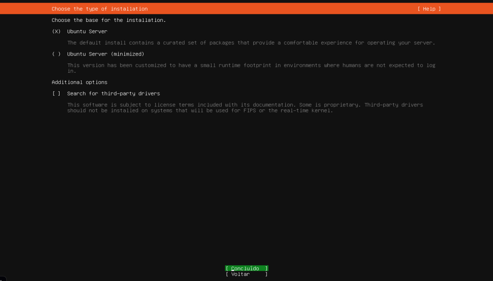
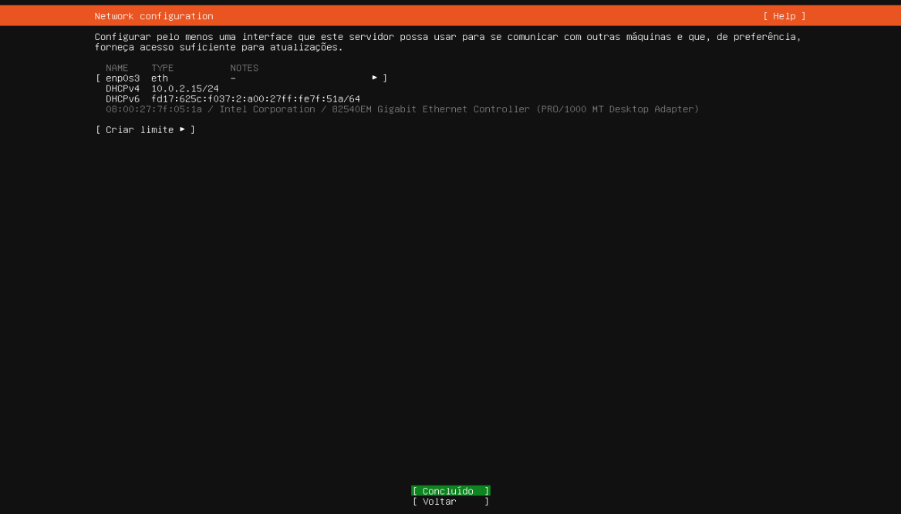
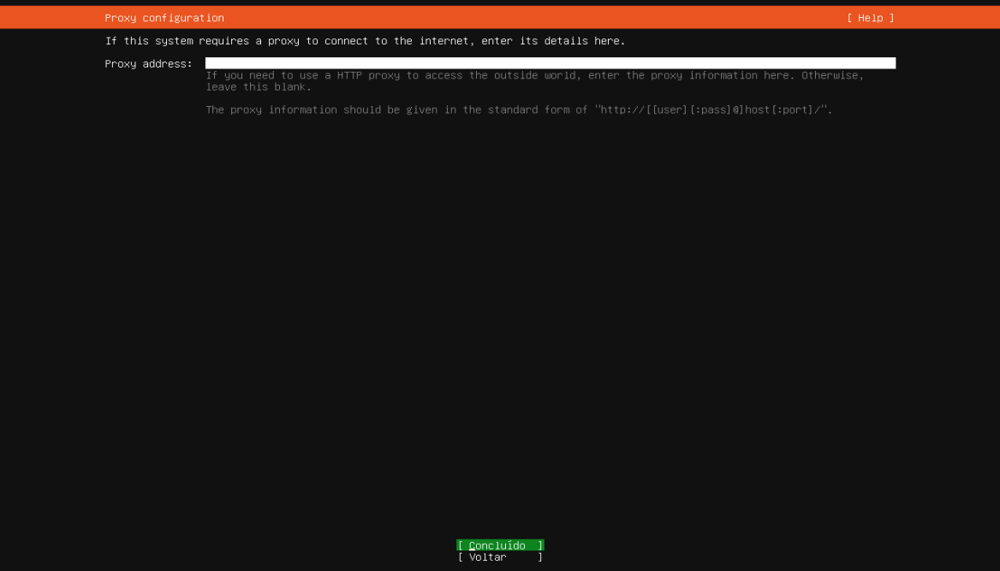
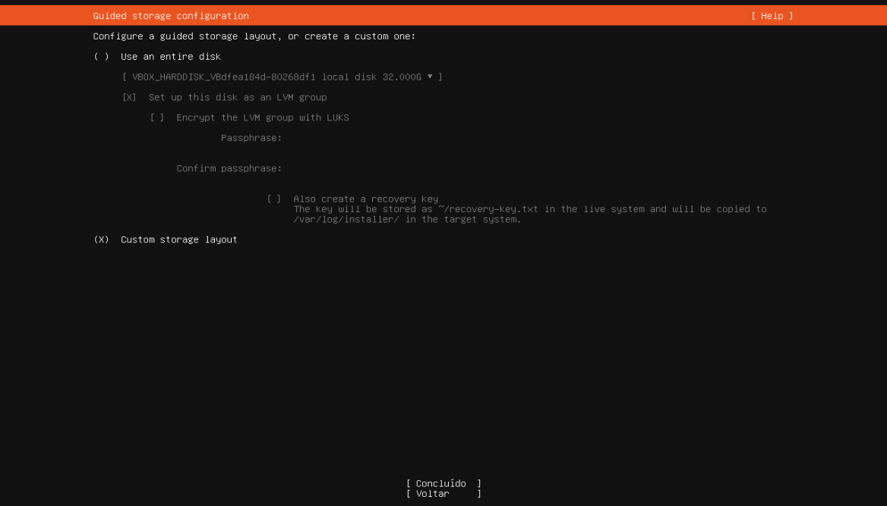
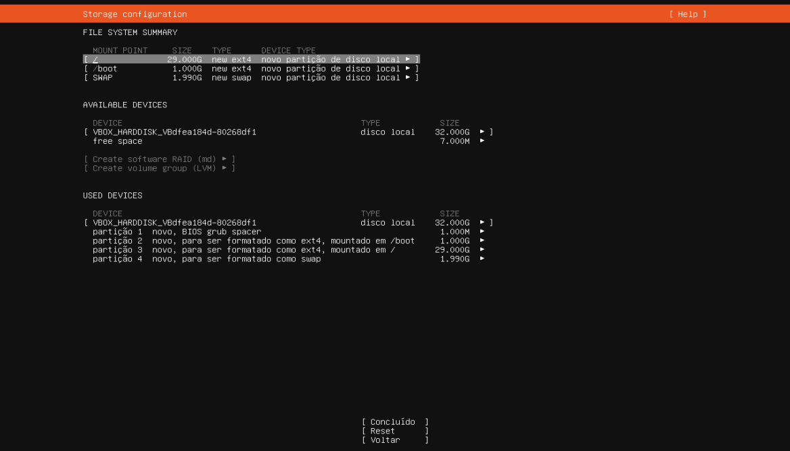
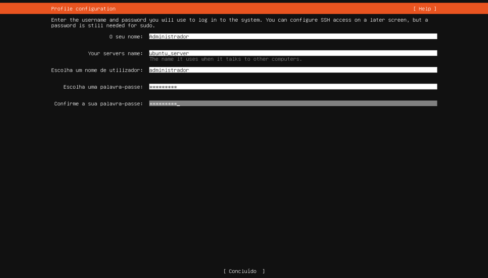
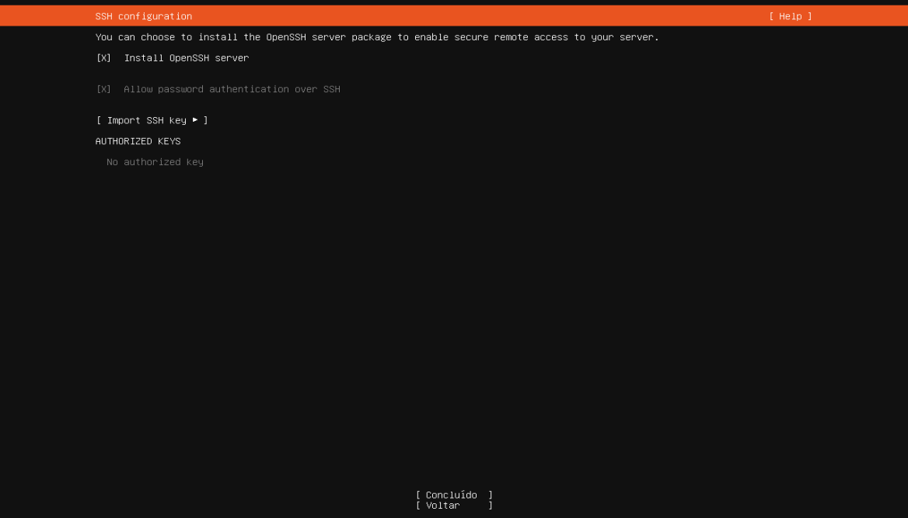
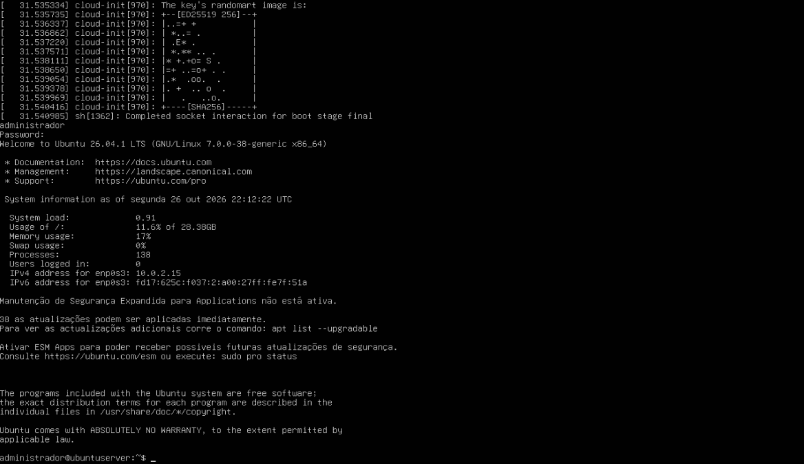

# Instalação do Ubuntu Server na máquina virtual

Segui todos os passos presentes no arquivo MD do repositório do professor Alaelson.

## Configurações da VM

- RAM: 2048 MiB
- CPUs: 3 CPUs
- Disco: 32 GiB

## Passos da instalação

Foi baixada a ISO 26.0.1 LTS do Ubuntu Server

Baixei, configurei a máquina virtual com as configurações descritas anteriormentes e iniciei.
 

Após isso, a instalação começou e defini as configurações como nas seguintes fotos:

 
 
 
 
 
 
 
 

Depois das configurações, o ubuntu foi instalado e iniciado:

 

E em seguida, executei um comando para atualizar o banco de metadados de pacotes da distribuição:

 
