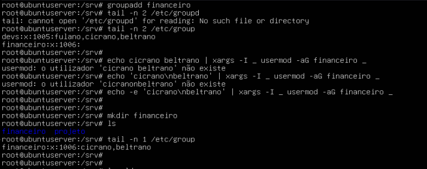
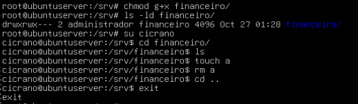

# Administração de usuários, grupos e permissões no Linux

## Atividade

### Criação do grupo, pasta compartilhada e inserção de usuários

- Criar grupo `financeiro`;
- Associar usuário `cicrano` e `beltrano`
- Criar uma pasta compartilhada `/srv/financeiro`

 

### Definição de permissões

- As permissões devem ser as seguintes:
    - `administrador` deve ser o dono e ter controle total.
    - O grupo `financeiro` deve ser o grupo associado e seus membros terem permissões de leitura e escrita.
    - Outros grupos ou usuários não devem ter nenhum acesso.

 

    

### Demonstração

- Demonstrar que:
    - Cicrano consegue alterar e criar arquivos normalmente.
    - Fulano e Novato recebem `Permission denied`.

Aqui não consegui acessar com o Cicrano, precisei aumentar a permissão para 7 para que ele conseguisse acessar a pasta. 

Uso bem-sucedido do Cicrano: 

 

Problemas de permissão do Fulano e Novato: 
