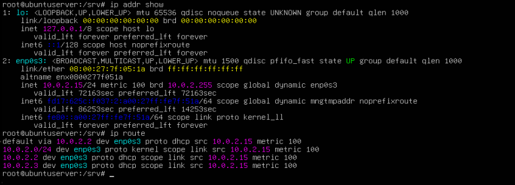
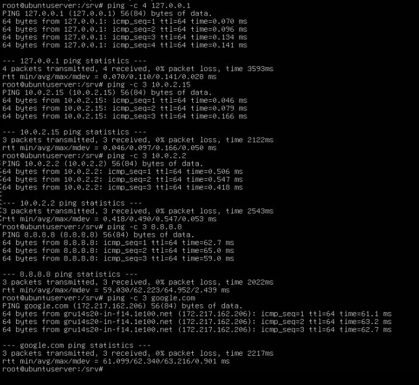

# Interfaces e Endereçamento de Rede

## Informações Pessoais

Nome: Vítor Marques de Albuquerque
Matrícula: 2024332995
Turma: 913-A
Turno: Matutino
Data: 26/10/2026

## Ambiente

- RAM: 2048 MiB
- CPUs: 3 CPUs
- Disco: 32 GiB
- Interface: enp0s3
- Endereço IPv4 local: 10.0.2.15
- Endereço MAC: 08:00:27:7f:05:1a
- Gateway padrão: 10.0.2.2

## Procedimento

Todos os comandos executados, em ordem:
1. `ip addr show`
2. `ip route`
3. `ping -c 4 127.0.0.1`
4. `ping -c 3 10.0.2.15`
5. `ping -c 3 10.0.2.2`
6. `ping -c 3 8.8.8.8`
7. `ping -c 3 google.com`

## Testes

`ip addr show` e `ip route`: 

 

Teste dos primeiros pings: 

 
